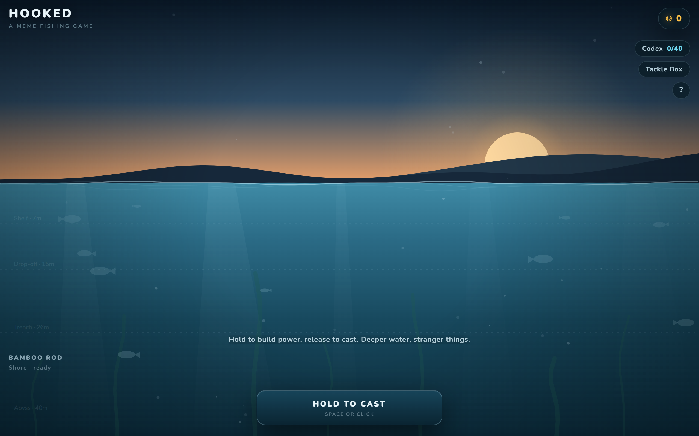

# 🎣 HOOKED

**A meme fishing game.** Cast out, wait for the bite, hook it, then fight it in. You will catch fish. You will also catch a USB-C cable, a CAPTCHA, a sentient sourdough starter, and the one that got away.

**[▶ Play it now](https://osman3n.github.io/hooked/)**



---

## Why it exists

Fishing minigames are the most-copied, least-understood mechanic in games. Most reduce to a progress bar that fills while you hold a button. The good ones are built on a **three-beat loop**:

1. **Charge** — how far do you cast? Distance is a real decision, not flavour.
2. **React** — the bite is a window. Miss it and the fish is gone.
3. **Fight** — two competing clocks. The fish pulls *and* it webs. You cannot just hold.

HOOKED is an attempt to build those three beats properly in ~3,100 lines of dependency-free JavaScript, and to make the reward for doing it well something funnier than a trout.

## The loop

| Beat | What you do | What the game asks |
| --- | --- | --- |
| **Cast** | Hold, release on the gold mark | The sweet spot is ~78% power — overshoot and you cast short |
| **Wait** | Do nothing. Breathe. | Fake nibbles are indistinguishable from real ones until the last moment |
| **Bite** | Press within a ~0.95 s window | Every miss is a fish you will never see |
| **Fight** | Hold to reel, release to ease | Tension and progress are both clocks. Riding the edge fills LINE ~2× faster than playing safe |

### The fight is the game

There is no way to brute-force it:

- **Holding forever snaps the line.** Tension has a hold ramp — the longer you crank without easing, the faster it climbs.
- **Never reeling loses the fish.** Slack accumulates; after 4.5 s it shakes the hook (`escaped`).
- **Playing it safe is slow, not safe.** Progress scales with tension: 0.55× at slack, 1.0× at 66. Wobbling in the middle means every fight runs near its 30–80 s clock.
- **Surges are the tell.** A surging fish keeps pulling even as you ease, so releasing is mandatory exactly when it feels worst.
- **`PERFECT` is a choice, not a bonus.** It requires keeping peak tension under 60 **and** landing it — a deliberately gentle, slow fight. It pays ×1.5.

That gives four distinct ways to lose: snap at 100 tension, let slack hit 4.5 s, run out the fish's clock, or fumble the bite.

## What you can catch

40 things across five depth bands. Roughly a third are fish; the rest are the sea's honest opinion about the internet.

| Depth | Band | Examples |
| --- | --- | --- |
| 0–7 m | Shore | Tiddler, Mud Snail, One Sock, Soggy Receipt, Sardine, A Boot |
| 7–15 m | Shelf | Anxious Pufferfish, Crab With Attitude, Sea Bass. Again., Single AirPod, WiFi Router 1 Bar, USB-C Wrong Way Up, Rubber Duck (Senior), Existential Jellyfish, Croissant, Suspiciously Long Eel |
| 15–26 m | Drop-off | Octopus No Plans, Sad Anglerfish, Mildly Threatening Swordfish, The Last Pringle, CAPTCHA, A Screenshot of an NFT, Phone at 1%, A Beige Flag, An Unlabelled Vibe, Group Chat (Muted) |
| 26–40 m | Trench | Ghost Carp, Coelacanth, Giant Squid (Small In Person), Sentient Sourdough Starter, The Algorithm, The Text You Never Sent, Eternal Loading Spinner, Your Ex's Playlist, 404, Not Found |
| 40 m+ | Abyss | The Kraken's Younger Cousin, Moonfish, The Backrooms Key, Schrödinger's Fish, The One That Got Away |

Rarity split: 8 common · 10 uncommon · 12 rare · 5 epic · 3 legendary · 2 mythic.

Deeper water does not merely pay better — it has **its own roster**. A Shore-only player literally cannot complete the codex, which is why the shop gates rods on codex progress (`ROD_GATE = [0, 3, 9, 18]`) rather than on money: a lucky deep cast should be able to pay for its own rod.

## Controls

| Action | Desktop | Touch |
| --- | --- | --- |
| Cast / hook / reel | Click or `Space` (hold to charge) | Tap and hold |
| Codex | `C` | Codex chip |
| Tackle Box | `B` | Tackle Box chip |
| Mute | `M` | `?` → mute |
| Close panel | `Esc` | ✕ |

## Running it

No build step, no dependencies, no `npm install`. It is plain ES modules served as static files.

```bash
npm run dev          # serves on http://localhost:8080
```

Any static server works (`python -m http.server`, `npx serve`, …). You cannot open `index.html` from the filesystem — ES modules require HTTP.

```bash
npm test             # 301 assertions, headless, no browser
npm run balance      # prints a per-species balance table for 6 player archetypes
npm run shots        # 8 screenshots via headless Chrome → shots/
```

`npm run shots` needs Chrome. It honours `CHROME_PATH`, otherwise looks for Chrome in the usual Windows location.

## How it is built

```
index.html          markup + HUD skeleton
css/style.css       design system: tokens, glass panels, all states
js/content.js       the 40 catches, rarity table, depth bands, rods, lures
js/sim.js           the entire game state machine — no DOM, no canvas
js/state.js         localStorage save, coins, codex, unlock rules
js/render.js        canvas scene: sky, water, kelp, particles, line, bobber
js/ui.js            DOM HUD, panels, phase→copy mapping
js/audio.js         all sound synthesised at runtime (no .wav in the repo)
js/main.js          bootstrap + the single rAF loop
tools/              dev server, CDP client, screenshots, self-test, balance probe
```

Deliberate choices:

- **No bundler, no framework, no assets.** The whole repo is text, so GitHub Pages serves the source directly and it scales to any DPI. The favicon is an inline SVG emoji.
- **`sim.js` has no DOM access.** The entire game is steppable in Node, which is why 301 assertions can run headless and why the balance probe can play 240 fights in two seconds.
- **All audio is synthesised.** `js/audio.js` builds tones and noise plus a generated convolver reverb, so there is nothing to download and no licensing question.
- **`tools/cdp.mjs` is a 120-line Chrome DevTools Protocol client** instead of Puppeteer, which keeps the zero-dependency promise while still catching real console errors — that client is how two of the bugs below were found.
- **Balance is tested, not vibed.** `tools/balance.mjs` plays every species with six strategies (beginner, steady, greedy, idle, masher, calm) and asserts the shape of the outcome, not just that it runs.

## Bugs worth remembering

Real ones, found by actually running the thing:

- **`addColorStop` threw mid-frame.** A gradient call passed `rgba(...)` into a hex-only `mix()`, producing `#NaNbaNaN0.55`. The canvas died. Caught only because the screenshot harness collects `Runtime.exceptionThrown`.
- **Holding the button always won.** Progress was `26 + 30/pull` per second — the weakest catch landed in under a second. Adding a hold ramp (tension climbs with continuous reel time) turned a formality into the actual mechanic.
- **A strong fish could not be caught at all.** Progress rate and slack loss nearly cancelled at `pull: 4.8`, so the mythic fight crawled for 191 s. Retuned both slopes.
- **Stalemate by design.** Surge cooldown was shorter than surge duration, so a strong fish surged continuously, progress sat at ×0.25, and the fight could be neither won nor lost. Rest now always outlasts the surge.
- **The codex rendered as one narrow column.** The JS set `id="codexGrid"` while the CSS targeted the *class* `.codexGrid`. An id/class mismatch that no unit test would catch.
- **Every request 403'd.** The dev server compared `target.startsWith(root)` with a relative root; `'index.html'.startsWith('.')` is false. Found by a HUD probe, not by a screenshot.

## License

MIT — see [LICENSE](LICENSE).
